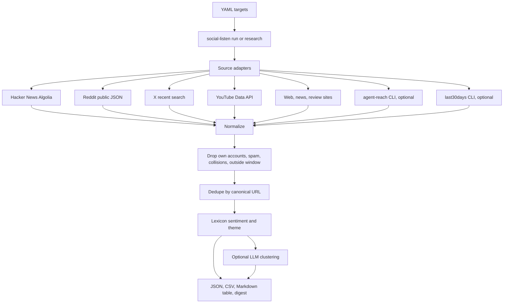

# Social Listen Agent

One read-only agent for public social listening. You give it a YAML file of brands, aliases, competitors, and exclusions. It searches the sources you turn on, drops the brand's own accounts, spam, and name collisions, and writes two things: the full list of mentions it actually retrieved, and a short digest of what those mentions say.

It does not post, like, reply, follow, or send DMs. It does not ship with anyone's brand names. Every run starts from the config you pass.

The tool merges four jobs that used to be separate assistants:

| Role | What this repo does with it |
| --- | --- |
| **Social Listen** | Orchestrates the run. Fans out to every enabled source, normalizes hits, and writes a short evidence-first digest. A daily cron stays quiet when no dated mention clears the bar. |
| **Overheard** | Keeps third-party mentions only. Drops the target's own handles and domains, spam, and negative keywords. Reports per-day counts, a last-7-days quiet/active verdict, and the age of each item in the wider window. |
| **Agent Reach** | Optional CLI adapter for [Panniantong/Agent-Reach](https://github.com/Panniantong/Agent-Reach). Searches login-walled or otherwise hard platforms (YouTube, Reddit, X, GitHub, Bilibili, XiaoHongShu, V2EX, and the other channels that CLI exposes) and records `ok`, `UPSTREAM_BROKEN`, `blocked`, or `not_installed`. |
| **last30days** | `social-listen research` looks back 30 days, clusters **KEY PATTERNS**, and labels the evidence `STRONG`, `THIN`, or `NONE`. When social evidence is not strong, it falls back to web, news, and review-site search. An optional adapter can also call [mvanhorn/last30days-skill](https://github.com/mvanhorn/last30days-skill). |

## Architecture



The pipeline still writes the raw mention list when no LLM key is set. The model may only group mention ids that were actually collected. A cluster that cites an unknown id is discarded, and the pattern sentence is built from those mentions rather than from the model's wording.

## Install

```bash
python -m venv .venv
source .venv/bin/activate
pip install -e ".[dev]"
cp .env.example .env
```

Python 3.11 or newer. Secrets stay in the environment or in `.env`, which is gitignored. `.env.example` lists every variable and commits no values.

## Run

Daily watch. Uses `window_days` from the config. Writes nothing human-facing when no dated mention falls in the window:

```bash
social-listen run --config configs/example.yaml --out out/today
```

Force the digest even on an empty day:

```bash
social-listen run --config configs/example.yaml --out out/today --no-quiet-empty
```

30-day research. Sets the window to 30 unless you pass `--days`. Always writes the digest, including a `NONE` result. If community sources are not `STRONG`, web, news, and review search run even when those toggles are off (`research_fallback: false` disables that).

```bash
social-listen research --config configs/example-persian.yaml --out out/research
```

One real keyless check against Hacker News, plus whatever else the config enables:

```bash
social-listen run --config configs/demo-public.yaml --out out/sqlite --no-quiet-empty --delay 0
```

`demo-public.yaml` watches the public project SQLite, with DuckDB as a competitor. It is a smoke test, not a client.

`social-listen doctor --config configs/example.yaml` runs the enabled sources with `max_hits: 1` and prints each status.

## Config

`configs/example.yaml` is a fictional brand, Vellamore Studio, with a competitor and a collision phrase (`vellum ore`). `configs/example-persian.yaml` adds Persian names (`ولامور`, `استودیو ولامور`) and a Persian review site (`emalls.ir`). Replace every name, domain, and handle before a real watch.

```yaml
name: vellamore-watch
window_days: 7
languages: [en, fa]          # omit to keep every detected language
quiet_below: 1               # dated mentions required before a daily digest is written
max_hits: 10                 # cap per request; the digest says the run was capped
targets:
  - id: vellamore
    role: brand              # brand, competitor, or question
    names: ["Vellamore Studio", "ولامور"]
    aliases: ["Vellamore"]
    domains: ["vellamore.example"]   # pages on these hosts are the brand's own content
    handles: ["vellamore"]           # posts by these accounts are dropped
    negative_keywords: ["vellum ore"]
sources:
  hackernews: true
  reddit: true
  x: true
  youtube: true
  news: true
  web: true
  reviews: true
  agent_reach: false         # optional CLI
  last30days: false          # optional CLI; built-in research does not need it
```

A hit is kept only when the stored title or text contains a name or alias, none of that target's negative keywords, and the page is not on the target's own domain or written by the target's own handle. Third-party posts that merely link to the brand's site are kept. The link you get is the place the person spoke (the Hacker News item, the Reddit permalink, the post URL), not a fabricated citation.

Terms shorter than two characters are rejected. Single tokens match on word boundaries, so `ai` does not match `snail`. Phrases and Persian text match as phrases, with Arabic yeh/kaf and ZWNJ folded only for matching. The quote that is stored is the original text.

## Output

When the bar is cleared (or you passed `--no-quiet-empty`):

| File | Contents |
| --- | --- |
| `mentions.json` | Every kept mention: source, url, author, handle, date, text, language, engagement, targets, sentiment, themes |
| `mentions.csv` | The same rows, UTF-8 with BOM |
| `mentions.md` | A Markdown table, text truncated for reading |
| `digest.md` | 7-day verdict, per-day counts, key patterns, quotes with links, competitor counts, source status |
| `marketing.md` | Plain-language summary. A Persian block is added when `fa` is in `languages` |
| `sources.json`, `run.json` | Machine-readable status |

On a quiet day, `run` writes `quiet.txt`, `run.json`, and `sources.json`. It does not write the digest or the mention dump. Undated web snippets do not clear the bar and do not flip the 7-day verdict, because the tool will not invent a date the source did not give.

Captured runs from this environment:

- [`examples/sqlite-demo/`](examples/sqlite-demo/) — SQLite on Hacker News, 31 Oct 2026. Reddit and DuckDuckGo were refused; X and YouTube had no keys. Quotes and links are from that response.
- [`examples/vellamore-quiet/`](examples/vellamore-quiet/) — fictional brand. No dated mention cleared the bar, so the digest and mention dump are omitted. `run.json` can still count undated web snippets; they do not make the day active.
- [`examples/vellamore-fa/`](examples/vellamore-fa/) — same brand with Persian names, `--no-quiet-empty`, signal `NONE`.

Regenerate them with the commands above. Counts change as the public sources change.

## Scheduling

[`.github/workflows/daily.yml`](.github/workflows/daily.yml) runs `social-listen run` at 06:00 UTC. Point `--config` at your own file. Empty days upload `quiet.txt` and do not produce a digest. Missing API secrets do not fail the job; that source is reported as `unconfigured`.

```bash
# the same command the workflow runs
social-listen run --config configs/example.yaml --out artifacts/listen
```

## Which adapters work without a key

| Source | Keyless | Needs |
| --- | --- | --- |
| Hacker News | Yes | Public Algolia API. Covered by tests, including a live call when the network allows it. |
| Reddit | Tries | `www.reddit.com/search.json` and `old.reddit.com`. Datacenter IPs often get HTTP 403, reported as `blocked`. No login fallback is bundled. |
| Web, news, reviews | Yes, when the provider answers | DuckDuckGo Lite, then DuckDuckGo HTML. HTTP 202 bot checks are `blocked`. Set `BRAVE_SEARCH_API_KEY` or `SERPER_API_KEY` to use those providers instead. `web_provider` may be `duckduckgo`, `brave`, or `serper`. |
| X | No | `X_BEARER_TOKEN`. Official recent search, read-only, about the last 7 days. A longer window is clamped and the report says the older days were not queried. The token is not used to post. |
| YouTube | No | `YOUTUBE_API_KEY` for Data API search. View counts are not requested, so engagement is left empty. Keyless YouTube search is the Agent Reach `youtube` channel. |
| Agent Reach | Depends on the channel | Install the GitHub CLI from Panniantong/Agent-Reach. Do not `pip install agent-reach`; upstream says that PyPI name is a different project. Default channels such as YouTube, GitHub, Bilibili, and V2EX need no key. Reddit, X, and XiaoHongShu need a login inside Agent Reach. Each channel gets its own status row. |
| last30days CLI | Optional | `LAST30DAYS_BIN` or a `last30days` executable. Only JSON items that include a public URL and text are kept. Prose that is not JSON is ignored so a quote cannot be invented from a paragraph. |
| LLM clustering | Optional | `OPENAI_API_KEY`, `OPENAI_BASE_URL`, `OPENAI_MODEL`. Any OpenAI-compatible chat endpoint. |

Engagement numbers are stored only when the source returned them. A missing count is omitted. It is not written as zero.

## Signal labels

`STRONG` means at least three mentions with a real timestamp inside the window, from at least two sources, and at least one of those is a community source: Hacker News, Reddit, X, YouTube, Bilibili, XiaoHongShu, V2EX, or GitHub. An Agent Reach channel counts only when that channel is one of those. Web, news, reviews, and the aggregate `last30days` source do not.

`THIN` means something was kept, but it did not clear that bar. A single busy source, or only undated web snippets, stays `THIN`.

`NONE` means nothing was kept.

The 7-day verdict is `active` only when a dated mention falls in those seven days. The wider window is whatever `window_days` / `--days` you set, and each quote is labeled with its age or with "date not provided".

## Upstream tools

This repository does not vendor Agent Reach or last30days. Both are MIT-licensed and called as optional programs. Their copyright notices are in [NOTICE](NOTICE).

- Agent Reach, Copyright (c) 2025 Agent Eyes. The adapter runs `agent-reach <channel> search` and reads the JSON envelope (`ok`, `result`, `error.hint`). A hint about login, cookies, or HTTP 401/403 is `blocked`. A crash, timeout, or non-JSON stdout is `UPSTREAM_BROKEN`. Channels and result shapes change upstream; items are kept only when a public URL and some text can be read out of the JSON.
- last30days-skill, Copyright (c) 2026 Matt Van Horn. `social-listen research` is an independent implementation of the same job: a 30-day window, key patterns, a strength label, collision filtering, and a web/review fallback when social evidence is thin. It is not a copy of that engine and does not reproduce its prompts. The optional CLI adapter passes `--emit json --days N` and ignores non-JSON output.

## Limitations

- A run is the set of hits retrieved under `max_hits`, not a census of the internet.
- Reddit's public JSON is often blocked from GitHub-hosted runners and other datacenter addresses.
- DuckDuckGo sometimes answers with HTTP 202 instead of results. Brave or Serper avoids that when you have a key.
- Web and news snippets usually have no timestamp. They are listed when a digest is written, and they do not make a quiet day active.
- Language detection is coarse. Latin text is tagged `en`. Persian-specific letters (`پ چ ژ گ`) are tagged `fa`. Other Arabic-script text is left unknown and kept, so a language filter does not drop it on a guess.
- Sentiment and themes come from a small English and Persian lexicon. `unknown` means the lexicon did not match. It is not a measured opinion.
- The only HTTP POST in the process is the optional Serper query and the optional LLM call. Social adapters are GET-only. Redirects are followed only to public https hosts, and API credentials are not sent when the host changes.
- X recent search does not cover more than about seven days, even when `window_days` is longer.

## Development

```bash
pip install -e ".[dev]"
ruff check src tests
pytest
```

CI is [`.github/workflows/ci.yml`](.github/workflows/ci.yml). The live Hacker News test skips if Algolia cannot be reached.

## License

MIT. See [LICENSE](LICENSE) and [NOTICE](NOTICE).

## فارسی

این مخزن یک ابزار شنیدن شبکه‌های اجتماعی است، فقط خواندنی. نام برند را در فایل YAML می‌دهید؛ ابزار در منابع عمومی جستجو می‌کند و دو خروجی می‌سازد: فهرست واقعی اشاره‌ها با لینک، و یک خلاصه کوتاه.

چهار کار در همین یک ابزار جمع شده است: شنیدن روزانه، پایش اشاره شخص ثالث (بدون حساب خود برند، بدون اسپم، بدون هم‌نامی)، اتصال اختیاری به Agent Reach برای پلتفرم‌هایی که ورود می‌خواهند، و تحقیق ۳۰ روزه با برچسب STRONG / THIN / NONE.

اگر در `languages` مقدار `fa` باشد، فایل `marketing.md` یک بند فارسی با همان عددها دارد. نقل‌قول‌ها ترجمه نمی‌شوند. روزی که اشاره تاریخ‌دار نباشد، اجرای روزانه ساکت می‌ماند و خلاصه نمی‌نویسد. هیچ کلیدی در مخزن نیست؛ رمزها فقط در محیط یا `.env` قرار می‌گیرند. نمونه نام فارسی در `configs/example-persian.yaml` است (`ولامور`).
